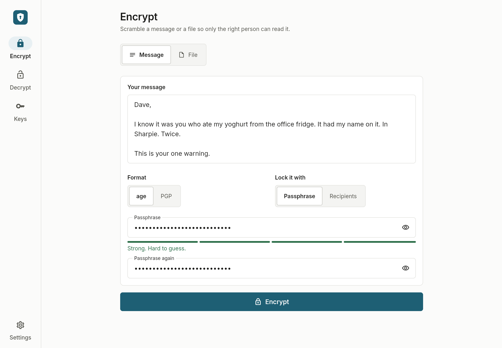
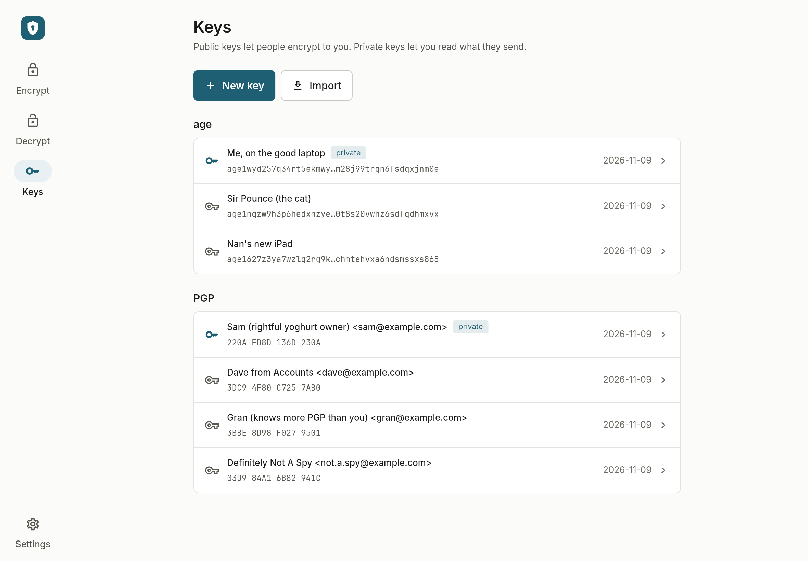
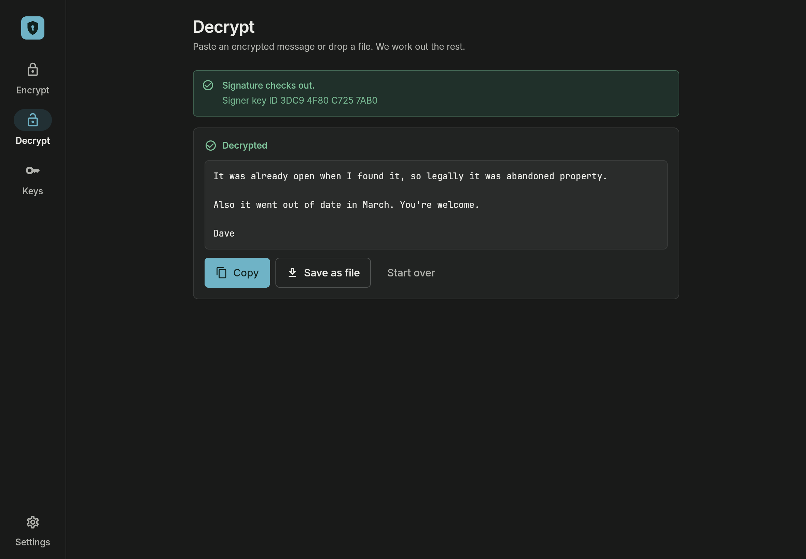
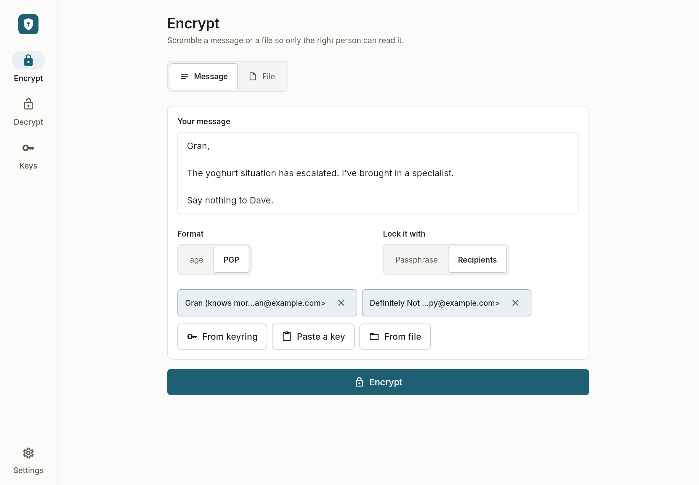
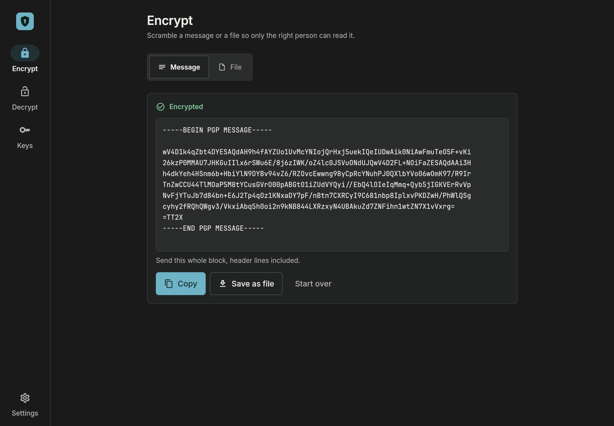
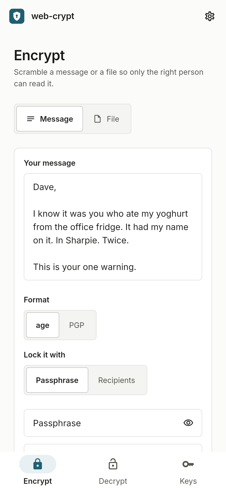
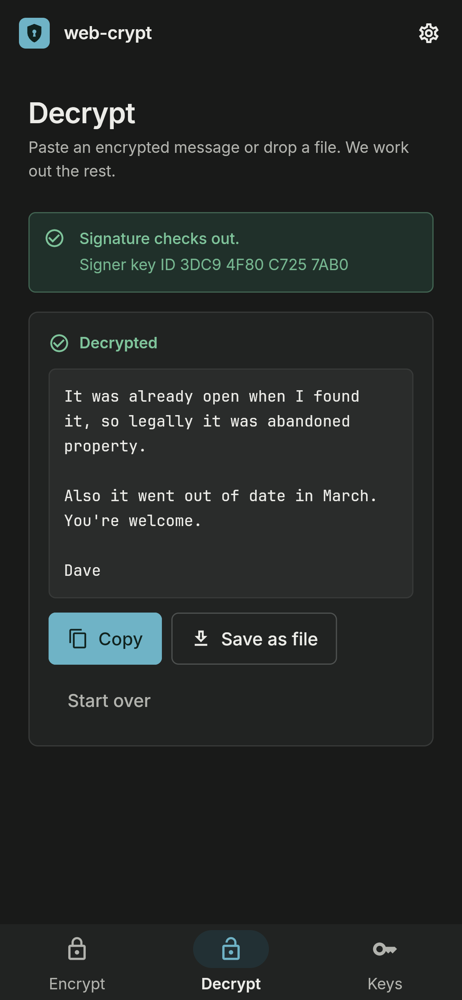

<h1 align="center">web-crypt</h1>
<p align="center">
  <br />
  🔐 <i>Encrypt and decrypt messages and files with age and PGP, all on your own device</i><br />
  <b>🌐 <a href="https://web-crypt.as93.net">web-crypt.as93.net</a></b>
</p>

<p align="center">
  
</p>

---

## About

web-crypt encrypts and decrypts text and files with [age](https://age-encryption.org) and [OpenPGP](https://www.openpgp.org). It runs in your browser or as a desktop app, and needs no network once it's open.

- Encrypt a message or a file, typed, pasted or dropped in
- Lock it with a passphrase, or with one or more people's public keys
- Decrypting works out the format on its own
- Generate, import and export age and PGP keypairs
- Private keys live in a keyring that's itself an age file, locked with your master password
- Runs on web and natively on Linux, macOS and Windows
- Installs as an app from Chrome or Edge, which can then open `.age`, `.gpg` and `.asc` files
- Light and dark mode, following your system

<details>
<summary>More screenshots</summary>

<table>
  <tr>
    <td></td>
    <td></td>
  </tr>
  <tr>
    <td></td>
    <td></td>
  </tr>
  <tr>
    <td align="center"></td>
    <td align="center"></td>
  </tr>
</table>

</details>

---

## Security

- No network requests at all, not even for fonts. CI loads every page in Chromium and Firefox and fails if a single request leaves the origin
- The only things saved are your preferences, public keys and the encrypted keyring, and you can wipe the lot from settings
- Private keys can be kept for the session only, so they never touch the disk
- Passphrases and keys are cleared once used, and never end up in logs, preferences or URLs
- A strict CSP (`default-src 'self'`, no inline scripts) on every deploy
- Every format and mode is round tripped against the real `age` and `gpg` binaries in CI, and all 114 vectors of the C2SP age testkit run through the real decrypt path

Encryption can't help if your device is already compromised. A dodgy browser extension or a keylogger sees what you type before web-crypt does.

### Limitations

- On web, large PGP files and PGP key generation freeze the tab until they finish, because browsers can't run them in the background. age streams fine, and desktop runs everything off the main thread
- Files over 200 MB get a warning on web, and 1 GB is the cap. Desktop has no cap for age
- It checks signatures on PGP messages you decrypt, but can't sign them yet
- Nothing is cached for offline use

---

## Deploying

#### Option 1: Docker

```bash
docker compose up --build
```

Then open [`localhost:8080`](http://localhost:8080). It's nginx on Alpine, running unprivileged with a read-only root.

#### Option 2: Static host

Build with `flutter build web --release --no-web-resources-cdn`, then upload `build/web` to any static host.<br>
`vercel.json` and `netlify.toml` already have the rewrites and security headers. On Vercel, just import the repo, it fetches Flutter itself. Netlify has no Flutter, so add a step to install 3.44.8 first.

#### Option 3: Desktop

Run `flutter build linux` (or `macos`, `windows`). The [Flutter docs](https://docs.flutter.dev/deployment/desktop) cover packaging.

---

## Developing

You'll need [Flutter](https://docs.flutter.dev/get-started/install) 3.44.8 and Git. The interop tests also need `age` and `gpg`.

```bash
git clone git@github.com:Lissy93/web-crypt.git
cd web-crypt
flutter pub get
flutter run -d chrome   # or linux, macos, windows
```

```bash
flutter analyze
flutter test                              # unit, widget and age testkit
flutter test integration_test -d linux    # the full flows on a real device
./tool/interop/run_interop.sh             # round trips against age and gpg
```

All the crypto lives in `lib/crypto/`, and the UI only reaches it through `crypto_service.dart`. The age and PGP code comes from vendored forks of `dage` and `dart_pg`, in `packages/`.

Every icon, the link preview and the install screenshots come from `node tool/interop/brand.mjs`. The logo is also drawn by `app_logo.dart` in the app and the splash in `web/index.html`, so change all three together.

---

## Contributing

Contributions are welcome. Follow the developing steps above, then open a PR.<br>
If you're new to GitHub or open source, [git-in.to](https://git-in.to) is a good place to start.

---

## License

> _**[Lissy93/web-crypt](https://github.com/Lissy93/web-crypt)** is licensed under [MIT](https://github.com/Lissy93/web-crypt/blob/HEAD/LICENSE) © [Alicia Sykes](https://aliciasykes.com) 2026._<br>
> <sup>Inter and JetBrains Mono are bundled under the <a href="https://openfontlicense.org">SIL Open Font License</a></sup>

<!-- License + Copyright -->
<p  align="center">
  <i>© <a href="https://aliciasykes.com">Alicia Sykes</a> 2026</i><br>
  <i>Licensed under <a href="https://gist.github.com/Lissy93/143d2ee01ccc5c052a17">MIT</a></i><br>
  <a href="https://github.com/lissy93"></a><br>
  <sup>Thanks for visiting :)</sup>
</p>

<!-- Dinosaurs are Awesome -->
<!--
                        . - ~ ~ ~ - .
      ..     _      .-~               ~-.
     //|     \ `..~                      `.
    || |      }  }              /       \  \
(\   \\ \~^..'                 |         }  \
 \`.-~  o      /       }       |        /    \
 (__          |       /        |       /      `.
  `- - ~ ~ -._|      /_ - ~ ~ ^|      /- _      `.
              |     /          |     /     ~-.     ~- _
              |_____|          |_____|         ~ - . _ _~_-_
-->
