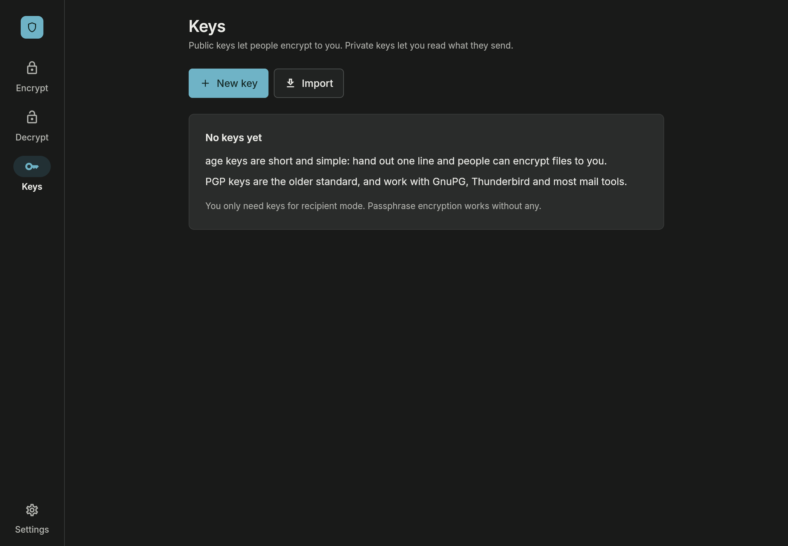
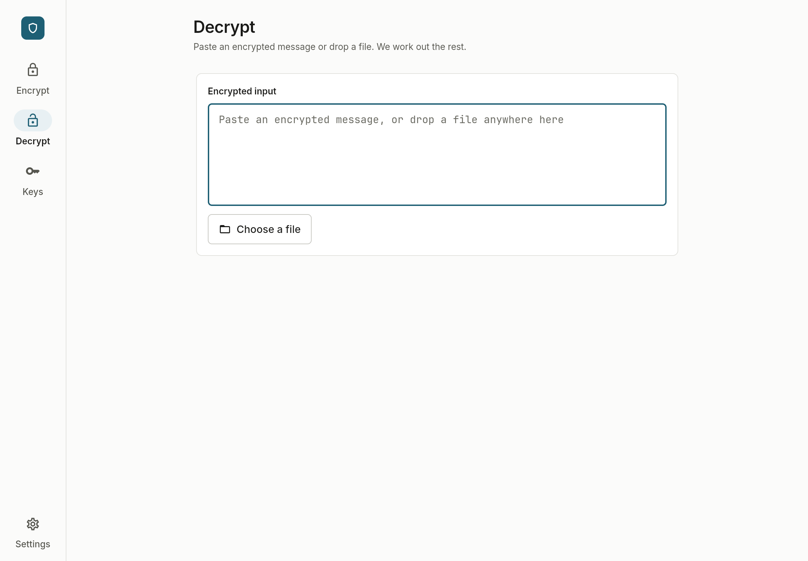
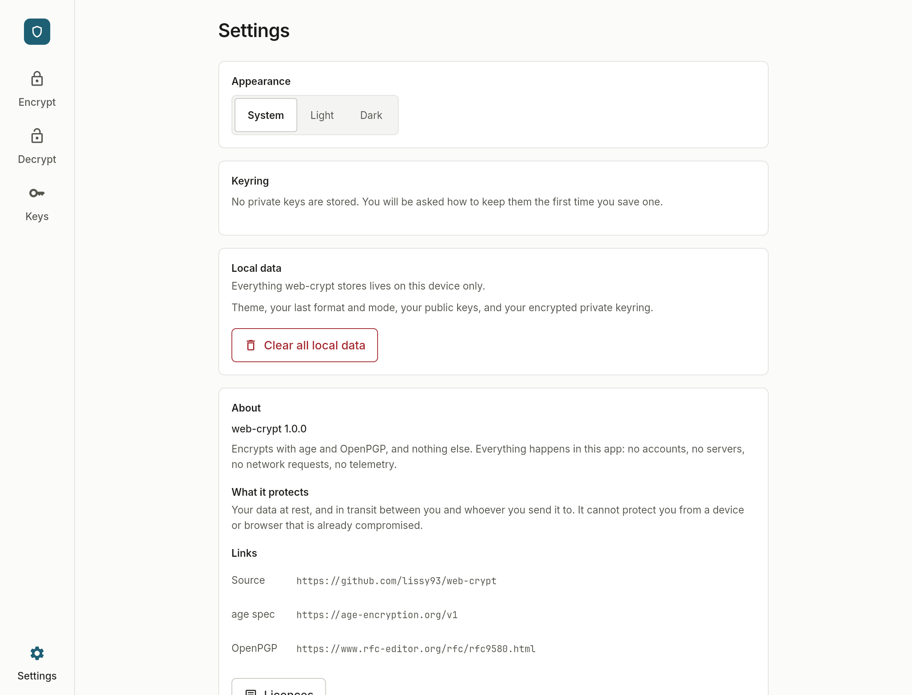
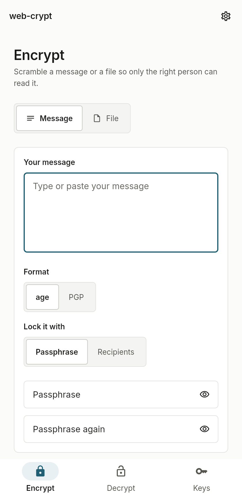

# web-crypt

Encrypt and decrypt messages and files with age and OpenPGP. Runs entirely on
the device, makes no network requests, and stores nothing on a server.

Anything web-crypt produces opens with `age` or `gpg`, and anything those tools
produce opens here.


## what it does

- messages and files, typed, pasted or dropped in
- age (`age-encryption.org/v1`) and OpenPGP (RFC 4880/9580)
- a passphrase, or one or more recipients' public keys
- decrypting picks the format on its own, with nothing to choose
- generate, import, export and store age and PGP keypairs, with private keys in
  a keyring that is itself a standard age file
- web, Linux, macOS and Windows

<table>
<tr>
<td width="50%"></td>
<td width="50%"></td>
</tr>
<tr>
<td></td>
<td></td>
</tr>
</table>

Both themes follow the system, and the layout holds from 360px up.

## security

Data is protected at rest, and in transit between sender and recipient. A
device or browser that is already compromised is outside what encryption can
reach: an extension or a keylogger sees what is typed before any of this runs.

- no network at runtime, not analytics, not fonts, not a favicon. the web build
  is compiled with `--no-web-resources-cdn`, every font is bundled, and CI
  loads every route in headless Chromium and Firefox, failing if a single
  request leaves the origin
- no accounts, no sync, no telemetry, no server to talk to
- the whole list of what is written down: preferences, public keys, and the
  encrypted private keyring. settings clears all of it
- private keys are sealed under a master password in age passphrase mode, so
  the keyring is a normal age file. session-only keeps them off disk entirely
- passphrases and key material are cleared from their controllers once done
  with, and never reach logs, preferences, urls or route state
- `default-src 'self'` with no remote origins and no inline scripts, in
  `index.html` and in every deploy config

## running it

```bash
flutter pub get
flutter run -d chrome        # or -d linux / macos / windows
```

## tests

```bash
flutter analyze
flutter test                              # unit, widget, age testkit vectors
flutter test integration_test -d linux    # the same flows on a device
./tool/interop/run_interop.sh             # needs age and gpg on PATH
```

`run_interop.sh` builds a CLI over `lib/crypto/`, the same code the app runs,
and round trips every format and mode against the real `age` and `gpg`
binaries in both directions, comparing checksums. 80 checks, and a failure is a
failed build. `flutter test` also runs all 114 vectors of the C2SP CCTV age
testkit through the real decrypt path.

## web build

```bash
flutter build web --release --no-web-resources-cdn

node tool/interop/check_no_network.mjs build/web
node tool/interop/smoke_web.mjs build/web
WEB_CRYPT_BROWSER=firefox node tool/interop/smoke_web.mjs build/web
node tool/interop/screenshots.mjs .github/screenshots
```

## docker

```bash
docker compose up --build          # http://localhost:8080
```

nginx on alpine, unprivileged on 8080, read-only root, healthcheck included.
The serve stage is `COPY` only, so buildx assembles `linux/amd64` and
`linux/arm64` from one host-arch bundle with no emulation.

Pointing the headless checks at the container runs them under the shipped CSP:

```bash
WEB_CRYPT_ORIGIN=http://127.0.0.1:8080 node tool/interop/smoke_web.mjs
```

`vercel.json` and `netlify.toml` carry the build command, the rewrites, the
wasm mime types and the same headers nginx sends. Neither host ships the
Flutter SDK, so both need an install step for the pinned version first.

## limits

- PGP on web is single threaded. browsers have no isolates and `dart_pg` works
  on whole messages rather than streams, so a large PGP file or a PGP keygen
  blocks the tab for as long as it takes. age streams and stays responsive, and
  on desktop every job runs in an isolate
- web input warns over 200 MB and stops at 1 GB. desktop streams from disk with
  no cap for age
- glyphs outside Inter and JetBrains Mono render as boxes rather than being
  fetched
- no service worker, so nothing is cached for offline use
- signatures on a decrypted message are surfaced, but producing them is not
  built yet

## layout

```
lib/
  app/         router, shell, theme
  core/        errors, shared widgets, utilities
  crypto/      the only code that touches a crypto library
  features/    encrypt, decrypt, keys, settings
  services/    files and storage, platform-conditional
packages/      vendored forks of dage and dart_pg
tool/interop/  the interop harness and the headless web checks
```

The UI never touches a crypto library. Everything goes through
`lib/crypto/crypto_service.dart`, which runs the work in an isolate on native.

## licence

MIT, see [LICENSE](LICENSE). Inter and JetBrains Mono are bundled under the SIL
Open Font License.
